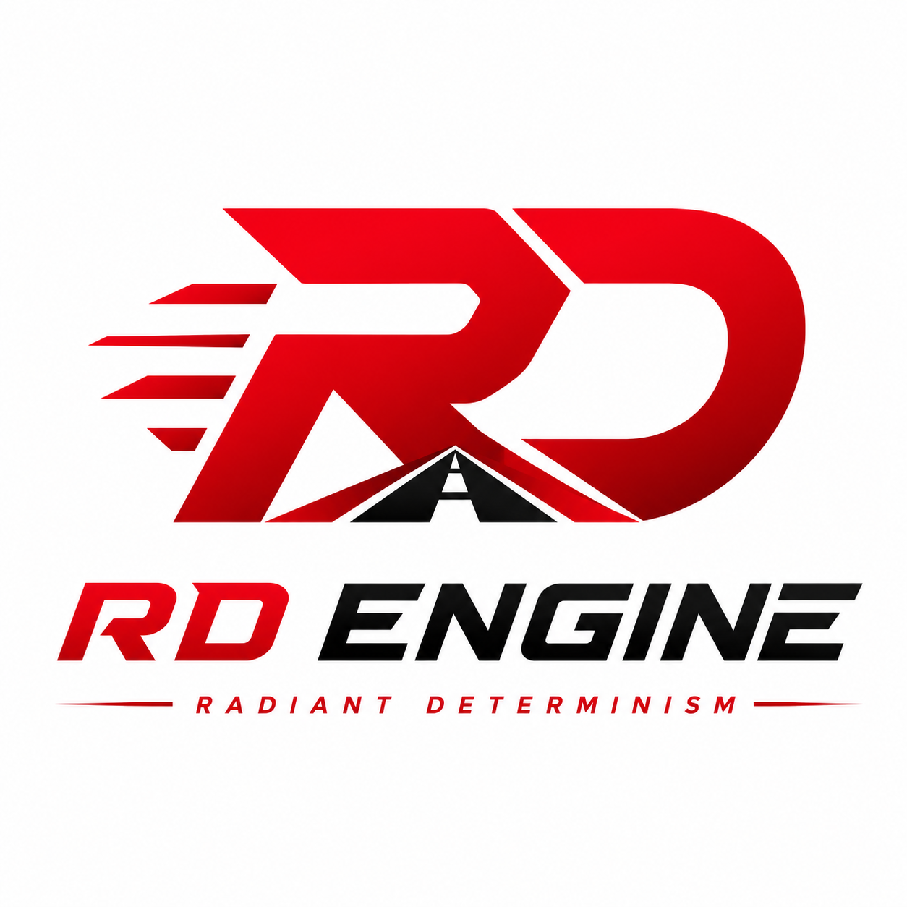
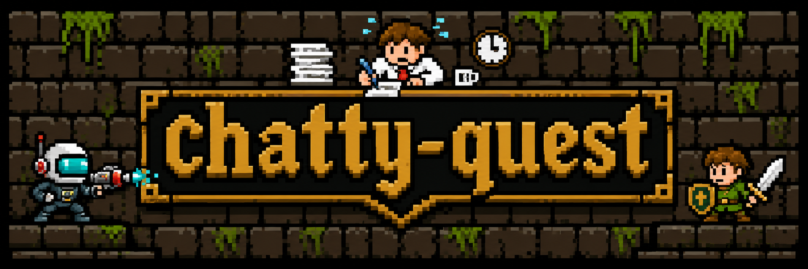
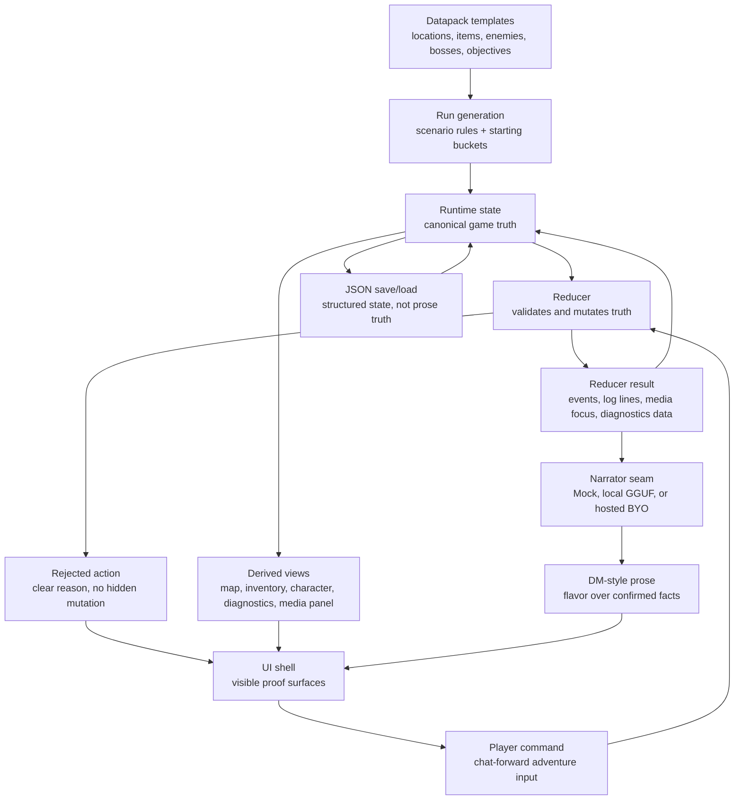
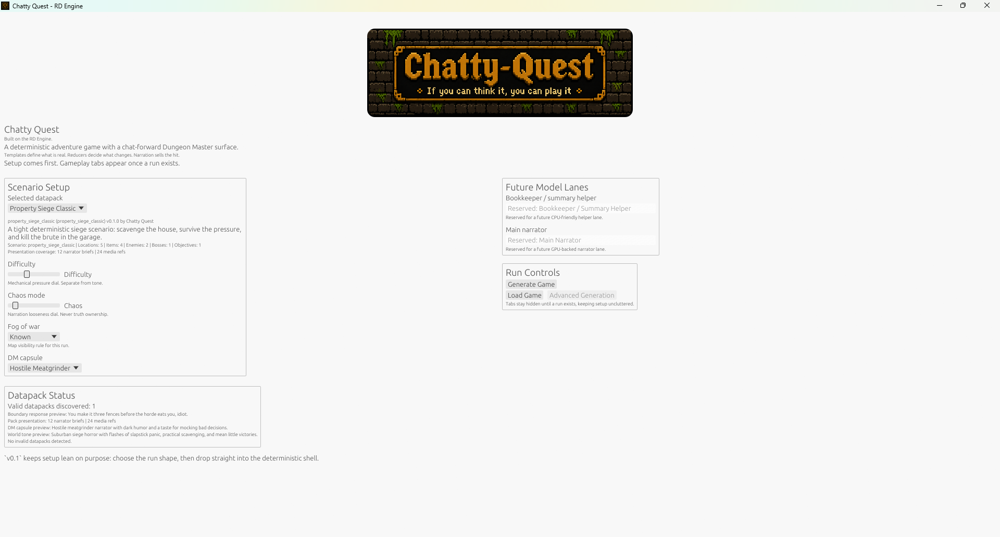
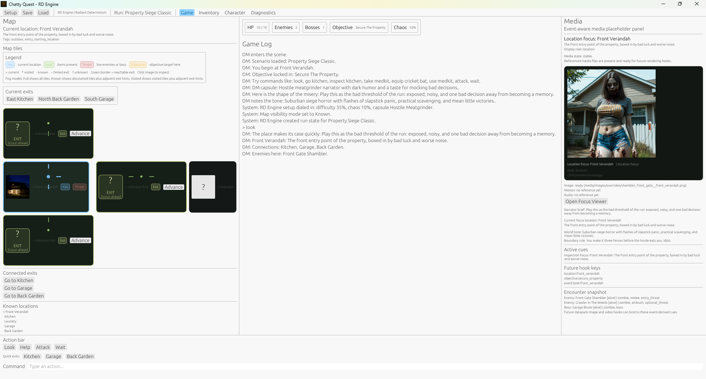
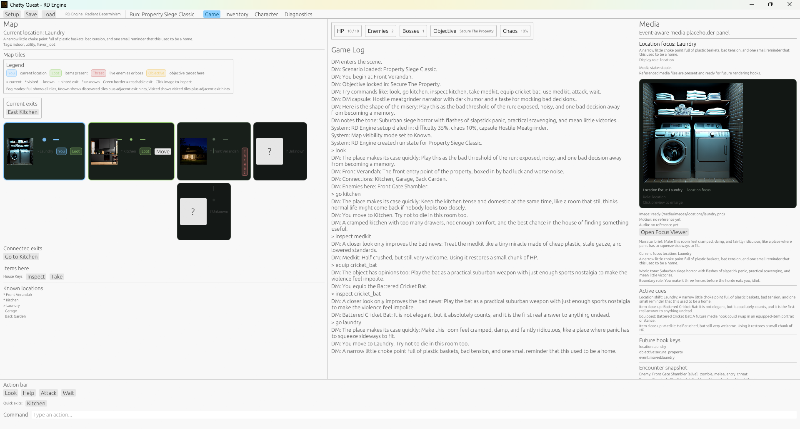
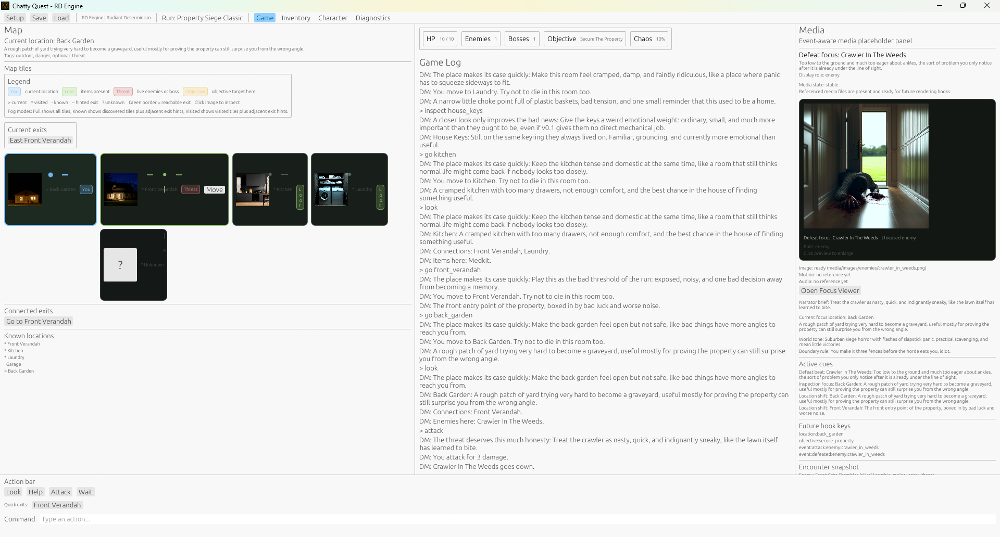
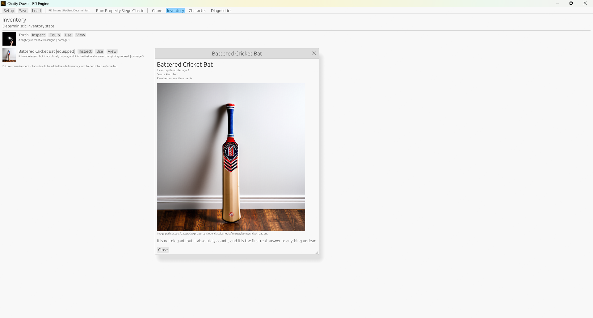

# Chatty Quest





Chatty Quest is the first game built on the `RD Engine`, the `Radiant Determinism Engine`.

The short version:

- templates are the nouns
- buckets are the current grammar
- reducers are the verbs
- narration is the accent
- media is the illustration

Chatty Quest is a Rust desktop adventure engine where deterministic templates and bucketed state create the world, while a narrator layer presents that world as a chat-forward Dungeon Master experience.

`Radiant Determinism` means the experience can feel dynamic, reactive, funny, and alive, while every meaningful gameplay payoff is grounded in deterministic state, reducer-confirmed mutations, and visible UI updates.

Current release status:

- `v0.1` is accepted as the historical first playable release
- the desktop `egui/eframe` shell is playable end-to-end
- datapack discovery, deterministic run generation, reducer actions, bounded narrator adapters, media focus, diagnostics, and JSON save/load are wired and working
- the active branch extends the release slice with capability-gated runtime actors, generic ownership transfer, ability grants and progression, media pools, player-library proposals, and controller-neutral action timing
- `cargo test` currently passes with `318` automated tests
- `cargo clippy --all-targets --all-features -- -D warnings` passes
- the original `v0.1` live manual sweep passed on `2026-06-11`, and the current branch has refreshed sweep/audit notes dated `2026-07-28`

`v0.1` is focused on one playable scenario pack:

- `Property Siege Classic`

The goal is to prove:

- datapack-driven scenario loading
- deterministic run state
- reducer-owned game truth
- a replaceable narrator seam
- save/load reliability

## Current Engine Contract

The current engine follows a small set of rules that apply across content families:

- A capability is the root of a mechanical contract. Enabling it makes its dependent fields
  applicable; disabling it makes those mechanics unavailable.
- A runtime entity may act only through a host-validated action path it has the capability to use.
  Player, NPC, enemy, boss, pet, summon, and actor-capable item are controller or template
  differences, not separate combat systems.
- One reducer-confirmed `GameEvent` is projected into the common downstream shape
  `type | origin | impact | outcome`. Narration, media, diagnostics, summaries, and action traces
  consume that projection rather than independently reinterpreting event variants.
- Eligible entities own items. All ownership changes use `TransferItem`; `take`, `drop`, `give`,
  receive, equip, and theft are bounded routes into that one primitive.
- Ability templates are immutable definitions. `AbilityGrant` is the owned runtime copy that holds
  charges, expiry, cooldown, source, and progression consequences.
- Media is presentation only. It resolves by role and hierarchical pools from reducer-confirmed
  context; it never supplies mechanics.
- Focusing a visible entity is presentation selection, but it may derive a compact action list
  from the same host contracts that execute commands. The list exposes only currently meaningful
  actions; the reducer remains the final authority when a button is pressed.

The detailed contracts are linked below. They are the active architecture reference; historical
`v0.1` release documents remain records of what that release promised and verified.

## Storage Layout

Chatty Quest stores writable runtime data under the active app root. Source runs use the repository folder. Packaged executable runs use the executable's folder. Set `CHATTY_QUEST_BASE_PATH` to force a portable root for testing, scripts, or custom installs.

On first run the app creates the writable skeleton it needs, including `runtime/`, `runtime/saves/`, `runtime/config/`, `runtime/logs/`, `models/`, `datasets/`, and `handoff/`. Bundled gameplay content should ship beside the app root under `assets/datapacks/`.

## Narrator options

Chatty Quest has a bounded, model-agnostic narrator service: packs route reducer-approved events
to None, Mock, or the player-selected narrator. The deterministic engine remains the sole owner
of game truth.

### Local GGUF

The local llama.cpp option uses the Vulkan-enabled runtime under `runtime/bin/windows/` and any
GGUF placed in `models/local/`. In Setup, choose `Local llama.cpp / GGUF`, select the detected
filename, then start the scenario. Chatty Quest starts a dedicated local host for that model. Any
compatible GGUF can be selected; no model family is canonical.

```powershell
.\run-local-model.ps1 -Model 'your-model.gguf'
```

### Hosted BYO API key

Choose `BYO API Key` in Setup to reveal a provider selector for OpenAI, xAI, Anthropic, Google
Gemini, or a custom OpenAI-compatible endpoint. Selecting a provider (or clicking `Apply provider
defaults`) fills its current model and endpoint suggestions; both remain editable. Paste your key
into the masked field and start the scenario.

The key is held only for the current process. It is never written to title settings or run saves.
The other title-screen choices are restored from `runtime/config/title_setup.json`, including the
selected pack, narrator source/model/provider/endpoint, narration-event preferences, and play
controls.

Select a narrator explicitly in Setup. If a selected real backend is unavailable, its failure is
shown; it is never silently presented as Mock narration. Gameplay continues because reducer-owned
state does not depend on any narrator response.

### Narration and proposals

Narration is presentation-only. Reducer commands continue to resolve normally; other free text can
receive a narrator reply without changing the run. The host first classifies whether free text is a
proposal-worthy constructive/discovery intent; ordinary conversation remains narration-only. When
the host-owned gate permits it, the host reproducibly selects one authorized template kind and the
narrator fills that bounded form. The host validates it, shows an editable approval card, and only a
user-approved, reducer-valid proposal can become state. Narrators never mutate a run directly or
choose which kinds are available.

The narration-event checkboxes control *when* a selected narrator speaks. The Tight, Guided, Loose,
and Wild control controls the separate host-owned proposal gate: respectively 0%, 25%, 60%, and
100% for eligible free-text turns. Those choices affect proposal opportunity and template breadth,
not reducer authority.

The host also has a separate, cooldown-limited ambient-discovery gate after reducer ticks. It is
rare (2%/12 ticks in Guided, 4%/8 in Loose, 6%/6 in Wild), deterministic across save/load, and uses
the same host-selected form, editable approval, and reducer-validation path.

Setup also provides a **Random emergence allowed** whitelist for items, NPCs, enemies, bosses,
objectives, status effects, and routes. The host intersects this with the current play contract
before selecting a form, so chaos changes opportunity frequency while the player controls which
families are eligible to emerge.

## RD Engine Loop Map



## Screenshot Tour

Main menu and setup shell:



Active run examples:

| Front Verandah | Laundry |
| --- | --- |
|  |  |

| Crawler encounter | Inventory tab |
| --- | --- |
|  |  |

Release and verification docs:

- [docs/ZERO_KNOWLEDGE_USER_MANUAL.md](docs/ZERO_KNOWLEDGE_USER_MANUAL.md) - zero spoilers
- [docs/FULL_SPOILERS_USER_MANUAL.md](docs/FULL_SPOILERS_USER_MANUAL.md) - full spoilers
- [docs/V0_1_RELEASE_NOTES.md](docs/V0_1_RELEASE_NOTES.md)
- [docs/V0_1_ACCEPTANCE_AUDIT.md](docs/V0_1_ACCEPTANCE_AUDIT.md)
- [docs/V0_1_MANUAL_SWEEP.md](docs/V0_1_MANUAL_SWEEP.md)
- [docs/V0_2_MILESTONE_PLAN.md](docs/V0_2_MILESTONE_PLAN.md)
- [docs/V0_2_BARRICADE_SPEC.md](docs/V0_2_BARRICADE_SPEC.md)
- [docs/V0_2_NOISE_PRESSURE_SPEC.md](docs/V0_2_NOISE_PRESSURE_SPEC.md)

Media credit:

- in-game media for this release was created with help from [instance001/chatty-art](https://github.com/instance001/chatty-art)

Core project docs:

- [docs/DESIGN_INTENT.md](docs/DESIGN_INTENT.md)
- [docs/PROJECT_OVERVIEW.md](docs/PROJECT_OVERVIEW.md)
- [docs/RD_ENGINE_PRINCIPLES.md](docs/RD_ENGINE_PRINCIPLES.md)
- [docs/ARCHITECTURE.md](docs/ARCHITECTURE.md)
- [docs/COMMAND_BOUNDARY_SPEC.md](docs/COMMAND_BOUNDARY_SPEC.md)
- [docs/NARRATOR_CONTEXT_SPEC.md](docs/NARRATOR_CONTEXT_SPEC.md)
- [docs/NARRATOR_ADMISSION_SPEC.md](docs/NARRATOR_ADMISSION_SPEC.md)
- [docs/RUNTIME_MODEL_SPEC.md](docs/RUNTIME_MODEL_SPEC.md)
- [docs/REDUCER_RESULT_SPEC.md](docs/REDUCER_RESULT_SPEC.md)
- [docs/MODDING_GUIDE.md](docs/MODDING_GUIDE.md)
- [docs/TEMPLATE_CAPABILITY_REFERENCE.md](docs/TEMPLATE_CAPABILITY_REFERENCE.md)
- [docs/ABILITY_GRANTS_SPEC.md](docs/ABILITY_GRANTS_SPEC.md)
- [docs/ACTION_TIMING_SPEC.md](docs/ACTION_TIMING_SPEC.md)
- [docs/PLAYER_LIBRARY_SPEC.md](docs/PLAYER_LIBRARY_SPEC.md)
- [docs/POST_LIBRARY_MANUAL_SWEEP.md](docs/POST_LIBRARY_MANUAL_SWEEP.md)
- [docs/MEDIA_PANEL_SPEC.md](docs/MEDIA_PANEL_SPEC.md)
- [docs/ROLLING_SUMMARY_SPEC.md](docs/ROLLING_SUMMARY_SPEC.md)
- [docs/IMPLEMENTATION_ROADMAP.md](docs/IMPLEMENTATION_ROADMAP.md)
- [docs/UI_SHELL_SPEC.md](docs/UI_SHELL_SPEC.md)

Branding art used by the app and docs lives under [`assets/ui/branding/`](assets/ui/branding/).

Captured app screenshots for docs and release use live under [`assets/ui/screenshots/`](assets/ui/screenshots/).

## Related Docs

- [GLOSSARY.md](GLOSSARY.md)

## License

Chatty Quest is licensed under the GNU Affero General Public License v3.0.

See [LICENSE](LICENSE) for details.
